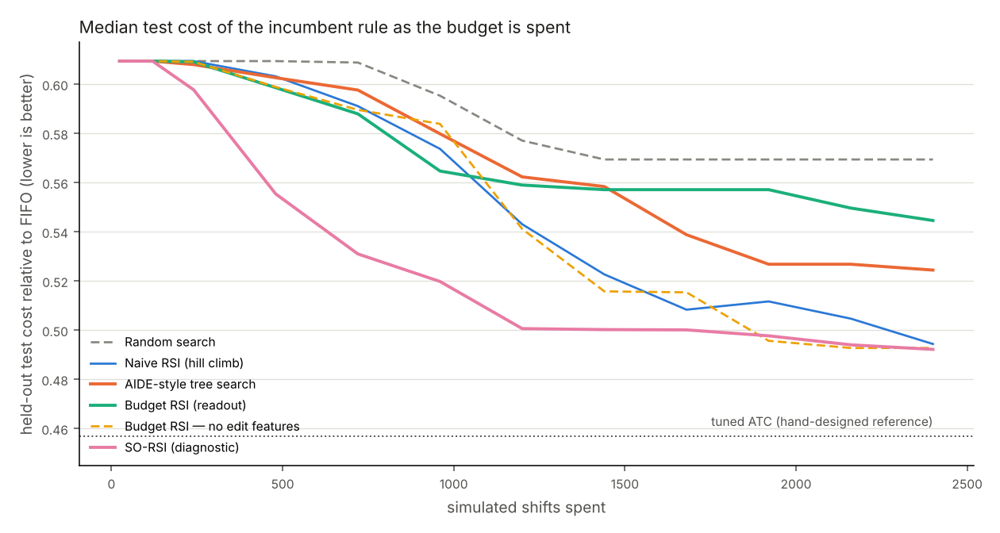
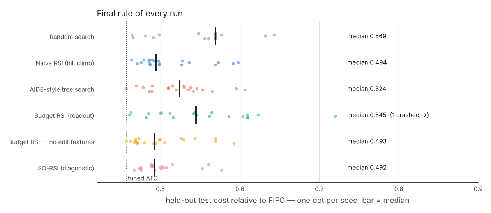

# Recursive self-improvement, three methods, one problem — SJSU Special Topics, Assignment 5

Gowri Preetham Gunisetty

**Problem (my own choice):** sequencing a hospital pharmacy's sterile-compounding queue. One clean-room hood, orders with a
preparation time, a due time and a clinical weight arrive through a shift; a **dispatch rule** decides what is prepared next.
Cost = total weighted tardiness. The thing being improved is the rule itself — a one-line program such as `w / p`.
All data is synthetic.

**Three RSI methods**, implemented on that problem and compared at equal cost:

| | Method | Idea | Code |
|---|---|---|---|
| 1 | **AIDE-style solution-tree search** | search a tree of complete solutions with *draft / debug / improve* | [`rsi/methods/aide_tree.py`](rsi/methods/aide_tree.py) |
| 2 | **Budget RSI** | score proposed edits with a linear readout *before* running them; evaluate only the pick | [`rsi/methods/budget_rsi.py`](rsi/methods/budget_rsi.py) |
| 3 | **SO-RSI** (second-order) | detect thrashing in the trace, run diagnostic probes, keep an inquiry memory, make targeted edits | [`rsi/methods/so_rsi.py`](rsi/methods/so_rsi.py) |

plus two baselines (random search, first-order hill climbing) and the remaining section-10 topics: multi-agent
coordination, an adaptive workflow with a meta-agent, Self-HPO, and the RSI-Index metric.

**17 codelabs** mirror section 10 of the course map (10.01–10.17): [`labs/README.md`](labs/README.md).
**Video scripts:** [`VIDEO_SCRIPTS.md`](VIDEO_SCRIPTS.md). Videos: _add three YouTube links (one per method)_.

```bash
pip install -r requirements.txt
python -m pytest tests -q              # 33 tests, ~5 s
python -m labs.lab_10_06_so_run_demo   # any single lab
python -m rsi.experiments              # the full study, ~5 min → results/
```

## Result — read this first

20 seeds per method, 2,400 simulated shifts per run (= 100 full evaluations), rule chosen by train score, **scored on 60
held-out shifts no method ever saw**. Cost is relative to FIFO (lower is better). Full tables: [`results/SUMMARY.md`](results/SUMMARY.md).

| | test cost, mean ± sd | median | vs hill climbing (paired, 95% interval) |
|---|---|---|---|
| EDD — the starting rule | 0.609 | | |
| WSPT (textbook) | 0.569 | | |
| **Tuned ATC (textbook, strongest hand-designed)** | **0.457** | | |
| Random search | 0.552 ± 0.049 | 0.569 | +0.040 [+0.012, +0.069] worse |
| Naive RSI (hill climbing) | 0.512 ± 0.041 | 0.494 | — |
| 1 · AIDE-style tree search | 0.523 ± 0.039 | 0.524 | +0.012 [−0.008, +0.033] no clear difference |
| 2 · Budget RSI (readout picks) | 1.015 ± 2.113 | 0.545 | worse — one run's rule crashed on a test shift |
| 2 · Budget RSI without edit features (ablation) | 0.502 ± 0.040 | 0.493 | −0.010 [−0.032, +0.014] no clear difference |
| 3 · SO-RSI | 0.501 ± 0.030 | 0.492 | −0.010 [−0.030, +0.010] no clear difference |




What the evidence supports:

1. **Every search improved a lot on its starting rule** (0.609 → about 0.50) and beat WSPT, but **no run of any method beat tuned ATC** (0 of the 120 runs in the main table). The best rule across all runs, picked by validation, scores 0.463 on test and is ATC with extra terms: `w / p * exp(-max(0, n) / (1.646 * p_avg)) * exp(-max(0, slack) / (2.36 * p_avg)) + 4.115 * n` — the searches rediscovered the textbook structure, not something better.
2. **At the full budget, none of the three methods is clearly better than plain hill climbing.** All intervals include zero except Budget RSI's, which is worse.
3. **SO-RSI gets there sooner.** Half-way through the budget it is ahead of hill climbing by 0.034 [0.012, 0.055], and its runs vary least (sd 0.030 vs 0.041). It also thrashes somewhat less: 12.2 vs 15.0 "same failed edit again" events per 100 steps. *Caveat: I looked at the half-budget point after seeing the curves, so treat it as exploratory.*
4. **Budget RSI's readout ranks edits better than chance but picks badly.** Out of sample, predicted and actual cost correlate (Spearman 0.36 ± 0.17), yet always evaluating the readout's top edit gave *worse* search than choosing a sibling at random (train 0.532 vs 0.487). Edits that improve are rare (18%) and the readout's favourite quarter is barely richer in them (20%); greedy use of it removes exploration. Using it only to filter out the worst half ([lab 10.05](labs/lab_10_05_budget_extend.py), separate seeds) recovers to the ablation's level, not above it.
5. **A new failure mode showed up on held-out data:** one Budget RSI run selected a rule that divides by a quantity that is never zero on the train shifts but is zero on a test shift. It crashes there (scored 9.99), which is why that row's mean is 1.015. I left it in.
6. **Coordination, the adaptive workflow and Self-HPO** all land within noise of their baselines (three coordinated workers −0.016 [−0.044, +0.011] vs independent; adaptive workflow −0.013 [−0.034, +0.007] vs hill climbing; Self-HPO +0.008 [−0.015, +0.032] vs the default tree search).
7. **Results move with the seed block.** In a separate 10-seed budget sweep the tree search's median at 2,400 shifts was 0.469, against 0.524 in the main 20-seed table. Differences of a few hundredths between methods here are not stable.

What this does **not** show: anything about these methods on their own benchmarks, or with an LLM proposing edits. This is
one small synthetic problem with a grammar-based proposer.

## How it works

```
proposer ──edit──► rule (one-line program) ──► Env.evaluate ──► cost on train shifts ──► method decides what to try next
(grammar or LLM)        AST-whitelisted            charges the budget
```

- **`rsi/problem.py`** — the queue simulator, instance generator, five disjoint seed ranges (train / steer / validation / test / shifted day), classical rules.
- **`rsi/program.py`** — the rule language. Rules are parsed and every AST node checked against a whitelist (8 variables, 6 guarded math functions, `+ − × ÷`), so a rule — including one written by an LLM — cannot import, read files or loop. Also the edit operators and the 8 edit features.
- **`rsi/env.py`** — the budget ledger. One unit = one simulated shift. Cached repeats are free; crashes cost what they used; a run that stops producing new rules is ended (stall guard).
- **`rsi/methods/`** — `baselines.py`, `aide_tree.py`, `budget_rsi.py`, `so_rsi.py`, and `common.py` with the two proposers.
- **`rsi/swarm.py`, `rsi/workflow.py`, `rsi/metrics.py`** — coordination, adaptive workflow + Self-HPO, RSI-Index and the paired bootstrap.
- **`rsi/experiments.py`** — the study. **`labs/`** — the 17 codelabs. **`tests/`** — 33 tests.

### Where is the "recursive" part?

| Level | Object improved | Here |
|---|---|---|
| 0 | the dispatch rule | every method |
| 1 | the improver's own choices, from its own trace | Budget RSI refits its readout on each new label; SO-RSI's monitor, memory and bans; the workflow's operator bandit |
| 2 | the improver's configuration | Self-HPO spends 30% of the budget choosing the tree search's settings |

No method here rewrites its own code. That is the honest ceiling of this demo.

## Protocol and its limits

- Same starting rule, same budget and same seeds for every method; paired bootstrap intervals over seeds.
- Method settings were chosen on development seeds 0–9 using the **validation** split. The study uses seeds 100–119; the Budget RSI extension uses 200–219; the budget sweep 300–309. Test data was never used to choose anything — except that the SO-RSI design went through three iterations on development seeds, and the half-budget comparison is post hoc.
- Offline, the proposer is a grammar-based editor, **not an LLM**. `RSI_LLM=1 OPENROUTER_API_KEY=… python -m rsi.experiments --seeds 3` swaps in an LLM proposer; its output is treated as untrusted text and must pass the same whitelist. That path is covered by tests with a fake model and **was not run against a real model**.
- Budget RSI and SO-RSI are implemented from the **course notes' summaries** of arXiv 2610.29121 and 2610.05701. I did not read the papers, so details may differ from the originals; `labs/lab_10_01` keeps source claims and my observations in separate columns. The AIDE-style search follows the published draft/debug/improve design.
- Cost is counted in simulated shifts. With an LLM proposer, proposing is no longer free, and Budget RSI's premise (proposing is cheap, evaluating is dear) would have to be re-costed.
